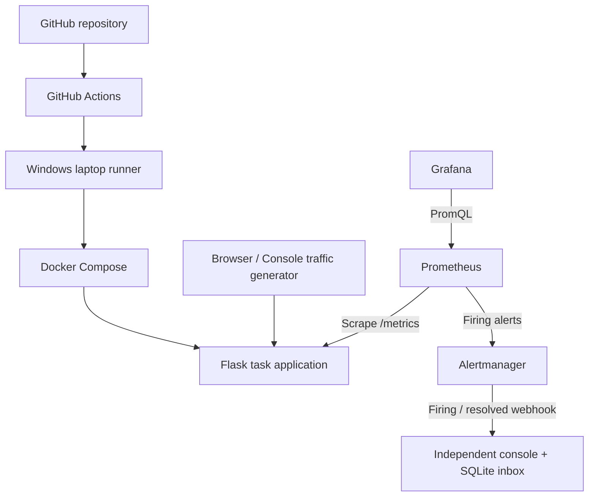

# Project overview and report foundation

## Abstract

PulseOps implements an automated local deployment and monitoring environment for a containerized task management application. GitHub Actions orchestrates a pipeline that builds and tests versioned container images and deploys them through a Windows self-hosted runner. Prometheus collects application request metrics, Grafana presents performance dashboards, and Alertmanager delivers incident notifications to a durable local inbox. An independent demo console generates controlled HTTP workloads to demonstrate normal operation, elevated server errors, high latency and recovery. Docker Compose and startup scripts make the environment reproducible without a cloud account.

## Problem and objectives

Manual deployment is repetitive, and checking whether a webpage loads does not establish that all requests are fast or successful. The project connects repeatable delivery with operational evidence. Objectives are to automate startup and deployment, verify releases using health and version checks, collect request-level measurements, provide useful dashboards, demonstrate sustained-condition alerts and notification delivery, preserve data across restarts, and restore a previous release on demand.

## Architecture

All five services run on one machine. The console and application use separate databases and processes. Configuration is version-controlled; runtime credentials and release records are ignored. Compose volumes retain application tasks, console notifications, Grafana configuration, Prometheus history and Alertmanager state.

## Modules

1. **Application:** task CRUD with parameterized SQLite statements, validation, a health endpoint, version identification and a metrics endpoint.
2. **Instrumentation:** counters for requests and task creation, a request-duration histogram, an in-progress gauge and release information. Health/metrics/static requests are excluded from business request metrics.
3. **Deployment:** configuration checks, image building, exact-image tests, service update, readiness checks, release identity verification and retained-image rollback.
4. **Collection:** five-second pull-based Prometheus scraping and short retention appropriate for a classroom environment.
5. **Visualization:** provisioned Grafana datasource and dashboard for request rate, duration, errors, route/status breakdowns and alert count.
6. **Alerting:** unreachable metrics endpoint, high error ratio and high p95 latency, each with a hold duration to avoid reacting to a single evaluation.
7. **Demonstration:** bounded traffic scenarios and a persistent inbox of actual notification deliveries. No synthetic pipeline successes or fabricated metric values are displayed.

## Methodology

The implementation follows develop → instrument → package → validate → deploy → verify → generate load → observe → detect → notify → recover. Tests validate both functionality and operational behavior. Pipeline checks establish whether a release is eligible to deploy. Readiness/version checks establish whether the intended image became active. Metrics and alert delivery establish how the running application behaves under controlled traffic.

## Evaluation

Record baseline and degraded request rate, error percentage and estimated p95 duration. Record failure injection time, first firing alert, webhook receipt and resolution. Use the JSON rehearsal report and screenshots as evidence. Compare actual observations with expected outcomes; do not invent results. Load-generator workers and request rate are different quantities. Histogram quantiles are estimates influenced by bucket boundaries.

## Limitations

This is a single-host teaching environment with loopback access, not a production hosting service. The laptop is a shared failure domain. There is no high availability, external availability probing, host resource exporter, centralized log system or distributed tracing. Monitoring detects symptoms and does not fix arbitrary defects. The local runner must only execute trusted code. Image rollback assumes backward-compatible database state. Future work can add Blackbox Exporter, Linux infrastructure monitoring, Loki, cloud deployment and multi-instance availability.

## Suggested submission contents

Introduction; problem statement; objectives; scope; requirements; architecture; application design; instrumentation; containerization; pipeline design; monitoring and queries; dashboard; alert rules and delivery; tests and measured results; screenshots; limitations; future work; conclusion; official references. Use README.md for setup instructions and DEMO.md for presentation preparation.
